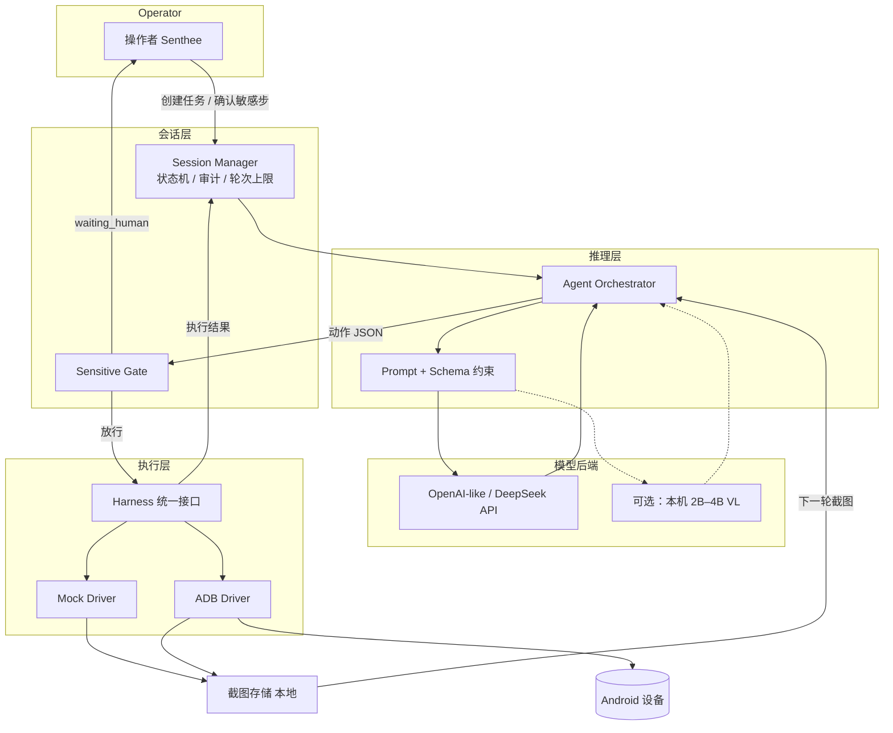
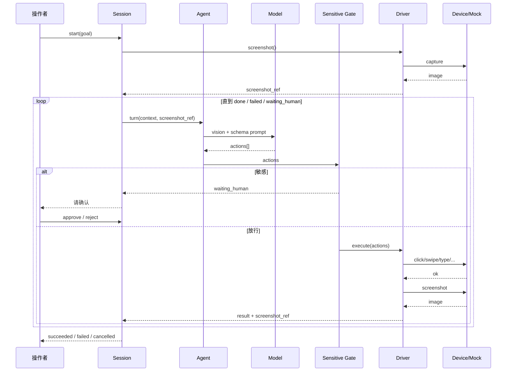
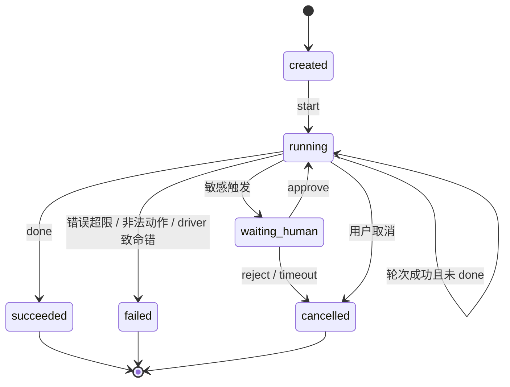

# 系统架构 — Mobile-Use Lite

| 字段 | 值 |
|------|-----|
| 文档版本 | v0.1（对齐 PRD v0.1） |
| 状态 | 设计候选 |
| 关联 | PRD · services · api · phases |

## 文档修订

| 版本 | 日期 | 说明 |
|------|------|------|
| v0.1 | 2026-10-16 | 首版：组件、数据流、商业对照、目录建议 |

---

## 1. 总览

Lite 拆成四层，协议优先于实现：

1. **会话层（Session）** — 任务目标、轮次、状态机、人工确认闸门  
2. **推理层（Agent / VL）** — 吃截图 + 上下文，吐结构化动作  
3. **执行层（Harness / Driver）** — mock 或 ADB，把动作落到设备并回传截图  
4. **模型后端（Model Backend）** — DeepSeek / OpenAI-like / 本地小 VL（可替换）

商业 Mobile-Use ≈「云端推理层 + SSE tool_calls」；Lite 自建推理与执行，接口形状可部分兼容以便对照，**运行时不依赖阿里云**。

---

## 2. 组件图



---

## 3. 数据流闭环（单轮）



**要点：**

- 执行前过 Sensitive gate；未确认不调用 driver 的副作用动作。  
- 每轮执行后**必须**尝试新截图，再推理。  
- 坐标在 **Agent 输出空间为 0–999**；**仅 Driver** 换算像素。

---

## 4. 与商业 Mobile-Use 对照

| 维度 | 阿里云 Mobile-Use | Mobile-Use Lite |
|------|-------------------|-----------------|
| 推理位置 | 云端托管 | 自选 API / 本地 VL |
| 传输 | SSE + tool_calls | 内部 API（可可选兼容 SSE/OpenAI-like，见 api.md） |
| 执行 | 调用方自备 | 本仓库 Harness（mock → ADB） |
| 动作语义 | 厂商 tool 集 | 自定六类动作 + 可扩展 |
| 坐标 | 需对照厂商文档 | 固定 0–999 → 像素 |
| 计费 | 商业按量 | 优先免费 DeepSeek + oc |
| 会话状态 | 厂商侧 + 调用方 | 自建 Session Manager |
| iOS | 视厂商能力 | P2 仅建议，不控整机 |

设计意图：**行为上同构「云规划 + 端执行」**，实现上可替换、可 mock、可断网演示（P0）。

---

## 5. 会话状态机



状态字段与 API 见 `api.md`。最大轮次默认 20（NFR-03）。

---

## 6. 动作在架构中的位置

- **Schema 单源：** 语义以 `api.md` 为准；日后代码生成/校验应对齐同一份。  
- **Agent：** 只产出符合 schema 的 JSON（可经校验器）。  
- **Gate：** 只读动作 + 截图启发式 / 任务关键词，不改坐标。  
- **Driver：** 校验范围、换算、执行、截图、返回 `ActionResult`。

---

## 7. 目录 / 模块划分（建议，本阶段不建代码）

```
mobile-use-lite/
  README.md
  docs/           # 本套 PRD 与设计（当前唯一交付）
  # —— 以下为开工后建议，现不创建 ——
  schemas/        # action.schema.json 等
  packages/
    session/      # 状态机、审计
    agent/        # orchestrator、prompt
    harness/      # Driver 接口
      mock/
      adb/
    model/        # OpenAI-like 客户端适配
  scripts/        # 剧本、demo 入口
  fixtures/       # 假截图、P0 剧本
```

原则：`harness` 与 `agent` 反向依赖禁止；`session` 编排二者。

---

## 8. 部署与运行拓扑（目标态）

| 阶段 | 拓扑 |
|------|------|
| P0 | 单机进程：Session + Agent（可桩）+ Mock Driver；截图来自 fixtures |
| P1 | 单机 + USB/无线 ADB；模型走网络 API |
| P2 | 可选：iPhone 本机 VL 独立小工具，**建议动作**经人确认后手动或受控执行 |

不引入 K8s/多租户。旁线项目保持单人可跑。

---

## 9. 架构决策记录（短）

| ADR | 决策 | 理由 |
|-----|------|------|
| ADR-1 | 执行与推理分离 | 对齐商业形态；可 mock |
| ADR-2 | 0–999 坐标在模型侧 | 分辨率无关；换算集中在 driver |
| ADR-3 | 敏感默认暂停 | 验收红线；降责任 |
| ADR-4 | Android 优先全自动 | iOS 沙盒导致控整机难 |
| ADR-5 | oc 优先，Origin 可选，Cloud Agent 默认关 | 成本与主线冲突控制 |

---

## 10. 变更同步

架构变更（新组件、改状态机、改目录）→ bump 本文件版本 → 检查 services.md / api.md / PRD FR 是否需改。
