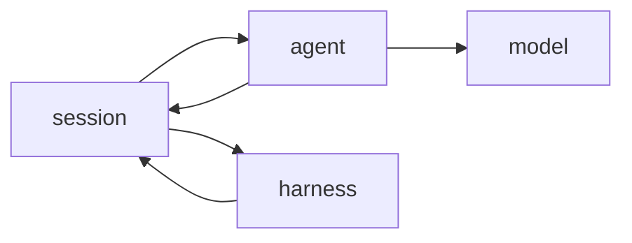

# 服务划分 — Mobile-Use Lite

| 字段 | 值 |
|------|-----|
| 文档版本 | v0.1（对齐 PRD v0.1） |
| 状态 | 设计候选 |
| 关联 | architecture · api · PRD |

## 文档修订

| 版本 | 日期 | 说明 |
|------|------|------|
| v0.1 | 2026-10-16 | 首版四服务：Agent / Harness / Session / Model Backend |

说明：P0 可为**单进程内模块**，不必拆成独立网络服务；下表按「逻辑服务」写清职责与 I/O，便于以后拆分。

---

## 1. 服务一览

| 服务 | 代号 | 职责一句话 |
|------|------|------------|
| 会话 / 状态服务 | `session` | 任务生命周期、轮次、闸门、审计 |
| Agent 推理服务 | `agent` | 组装上下文、调模型、校验动作 JSON |
| Driver / Harness | `harness` | 执行动作、截图、坐标换算 |
| 模型后端 | `model` | VL/LLM 推理适配（可替换） |

---

## 2. session — 会话 / 状态服务

### 2.1 职责

- 创建 / 查询 / 取消会话。  
- 维护状态机：`created` → `running` → `waiting_human` | `succeeded` | `failed` | `cancelled`。  
- 轮次计数、最大轮次、Sensitive gate 等待与超时。  
- 记录每轮：截图引用、模型原始输出（可截断）、校验后动作、执行结果、错误码。  
- 对外编排：需要截图时调 harness；需要决策时调 agent；需要确认时阻塞等人。

### 2.2 输入

| 输入 | 说明 |
|------|------|
| `goal` | 自然语言任务目标 |
| `driver_id` | `mock` \| `adb` |
| `config` | 最大轮次、模型后端名、是否启用敏感启发式 |
| 人工事件 | `approve` / `reject` / `cancel` |

### 2.3 输出

| 输出 | 说明 |
|------|------|
| `session_id` | 会话标识 |
| `status` | 见上 |
| `turns[]` | 轮次摘要 |
| 终端结果 | `succeeded` 时的 done 消息；或错误详情 |

### 2.4 依赖

- `agent`（决策）  
- `harness`（感知与执行）  
- 不直接依赖具体模型厂商 SDK（经 agent）

### 2.5 非职责

- 不做 VL 推理。  
- 不直接发 ADB 命令。

---

## 3. agent — Agent 推理服务

### 3.1 职责

- 根据 goal、历史动作摘要、当前截图引用，构造 prompt（含动作 schema 约束）。  
- 调用 `model`，解析为动作数组。  
- JSON Schema / 结构校验；非法则有限次重试或返回错误给 session。  
- 可选：把内部动作映射为「类 OpenAI tool_calls」形状（对照用，见 api.md）。

### 3.2 输入

| 输入 | 说明 |
|------|------|
| `session_id` / 上下文 | goal、历史、轮次号 |
| `screenshot_ref` | 路径或 ID；由 agent 或 model 适配层负责读字节 |
| `model_profile` | 例如 `deepseek-chat+vl` / `stub` / `ios-local-vl` |

### 3.3 输出

| 输出 | 说明 |
|------|------|
| `actions[]` | 符合 schema 的动作列表（可为空仅当错误路径） |
| `raw_model` | 可选，调试用 |
| `agent_error` | 解析失败等 |

### 3.4 依赖

- `model`  
- 只读 schema 定义（文档 / 日后 schemas/）

### 3.5 非职责

- 不执行点击。  
- 不做敏感最终裁决的「放行执行」（可提供启发式标签，**放行权在 session gate**）。

---

## 4. harness — Driver / 执行服务

### 4.1 职责

- 统一接口：`screenshot()`、`execute(actions)`、`device_info()`（宽高、密度、平台）。  
- **坐标换算：** 0–999 → 像素。  
- 实现：  
  - **MockDriver：** fixtures 剧本，按步切换假图。  
  - **AdbDriver（P1）：** `screencap` / `input tap` / `swipe` / `text` / `keyevent BACK` 等。  
- 返回每动作 `ActionResult` 与新 `screenshot_ref`。

### 4.2 输入

| 输入 | 说明 |
|------|------|
| `actions[]` | 已通过 gate 的动作 |
| 设备连接参数 | ADB serial 等（P1） |
| mock 剧本 ID | P0 |

### 4.3 输出

| 输出 | 说明 |
|------|------|
| `results[]` | per-action ok / error_code / message |
| `screenshot_ref` | 执行后截图 |
| `device_info` | width_px, height_px, platform |

### 4.4 依赖

- 系统 ADB（P1）或本地 fixtures（P0）  
- 不调用模型

### 4.5 非职责

- 不做任务规划。  
- 不实现 Sensitive 策略（只服从 session 是否调用 execute）。

---

## 5. model — 模型后端

### 5.1 职责

- 适配多种后端同一调用面：`complete(messages, images, tools_or_schema)`。  
- P0 可提供 **StubModel**（按剧本吐固定动作，便于无密钥演示）。  
- P0/P1 主路径：OpenAI-like HTTP（DeepSeek 等）。  
- P2 可选：本机 MLX/Core ML 小 VL，输出建议文本/JSON。

### 5.2 输入

| 输入 | 说明 |
|------|------|
| messages | 系统 + 用户（含目标与历史） |
| image | 截图字节或路径 |
| response_format / tools | schema 约束或 tool 定义 |

### 5.3 输出

| 输出 | 说明 |
|------|------|
| text 或 tool_calls | 由 agent 解析为内部 actions |
| usage | 可选 token 统计 |
| 错误 | 超时、鉴权、限流 |

### 5.4 依赖

- 网络 API 密钥（若非 stub）— **密钥不进仓库**  
- P2：本机推理运行时

### 5.5 非职责

- 不管会话状态。  
- 不接触 ADB。

---

## 6. 跨服务约定

| 约定 | 说明 |
|------|------|
| 截图传递 | 优先 `screenshot_ref`（路径/ID），避免多层拷贝大图 |
| 错误码 | 统一枚举，见 api.md；服务可附加 `detail` |
| 幂等 | `execute` 同轮默认非幂等；重试由 session 显式发起 |
| 日志 | session 记审计；model 原始输出可截断；密码类不落日志 |
| 进程模型 | v0.1 目标：库调用；预留 HTTP 内部 API 形状便于测 |

---

## 7. 与阶段映射

| 阶段 | session | agent | harness | model |
|------|---------|-------|---------|-------|
| P0 | 状态机 + gate | schema 校验 + 编排 | Mock | Stub 和/或 DeepSeek |
| P1 | 审计加强 | 同左 | + ADB | DeepSeek / OpenAI-like |
| P2 | 可接「建议」流 | 建议模式 | 可不自动执行 | 本机小 VL |
| P3 | — | — | — | 不做跨 App 长规划 |

---

## 8. 变更同步

增删服务或改 I/O → bump 版本 → 更新 architecture 组件图与 api 端点表。
